# Open Backup UI v1.0.0

**A new Operations experience, from the morning health check to the workload behind a failed backup.**

Version 1.0 brings focused Protection Lens views, capacity forecasting, reusable Policy Profiles, eleven interface languages, and a consistent interface across Veeam Backup & Replication, Microsoft 365 backup, Veeam ONE, and administration. Operations and Glass themes, a visual connection showcase, and optional HTTPS certificate management round out the release.

Screenshots show the project lab during the v1.0 revamp. Some captures predate the final navigation and filter refinements; the [visual guide](v1.0.0-gallery.md) identifies the capture set and provides current routes.

## The highlights

- **See what matters:** four Protection Lens views, each with its own operational metrics.
- **Investigate in context:** follow workloads, jobs, sessions, restore points, and repositories without losing the thread.
- **Plan ahead:** explore storage growth, retention, immutability, and backup hygiene from cached evidence refreshed every 30 minutes in the background.
- **Build once, reuse often:** a new job builder with reusable retention, guest-processing, and schedule profiles.
- **Move faster:** global search with previews, expandable filters, sortable grids, and phone navigation.
- **Work in your language:** eleven bundled languages for the migrated workspaces, including widget descriptions, counts, statuses, and investigation details.
- **Make it yours:** Operations, Glass Ocean, Glass Forest, and Glass Aurora, with light/dark modes and live appearance previews.
- **Connect and configure:** a screenshot-led introduction to the console and application settings for language and HTTPS certificates.

## Protection Lens

### Your protection picture, four ways

Choose **Overview**, **Job Operations**, **Capacity Watch**, or **Capacity Forecast** from a compact Lens selector with live mini previews. Mark a Lens as your default starting view for this browser.

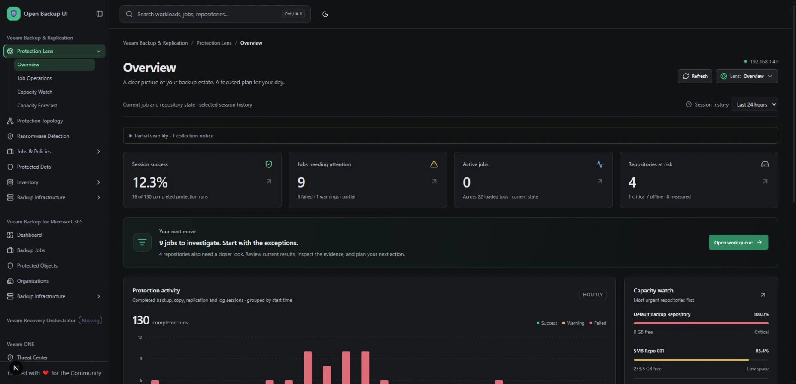

*One protection picture. Four focused views.*

### Job Operations

Move straight from failed, warning, active, or disabled jobs to the evidence that needs investigation. Search the queue, inspect sessions, and export the matching records.

*Start with the jobs that need attention.*

### Capacity Watch

Find repositories under pressure with capacity, free space, availability, and affected-job context. Missing measurements remain visible instead of appearing healthy.

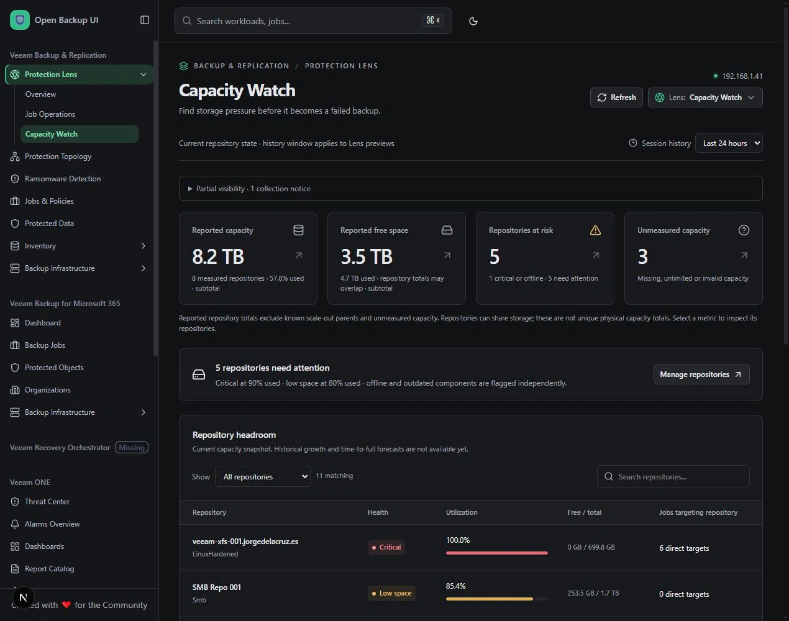

*Find storage pressure before the next backup.*

### Capacity Forecast

Compare retained backup-file history with a distinctly styled projection, then explore retention and incremental-growth scenarios. A separate physical-capacity trend uses collected repository measurements; it does not confuse file sizes with occupied disk blocks.

Planning evidence is cached in server memory for each authenticated source and principal. Saved VBR connections refresh in the background every **30 minutes**, even with the browser closed. The page opens the cached snapshot and shows when it was collected and when it will refresh. Use **Refresh** to request current evidence immediately. During background work or a transient refresh failure, the previous snapshot and its original timestamp remain visible, with the refresh state clearly shown.

The planning cache rebuilds after a server restart. Browser-only sessions can use cached evidence while connected, but require an active request for new collection. The separate physical-capacity collector continues to record measurements every 15 minutes. `CAPACITY_COLLECTOR_ENABLED=false` disables both background tasks; manual planning refresh remains available.

*Explore tomorrow's storage demand.*

### Retention, immutability, and backup hygiene

Investigate why files are retained, where configured immutability outlasts retention, and which backups need review. The background collector records capacity every 15 minutes while the server runs, even with no browser open.

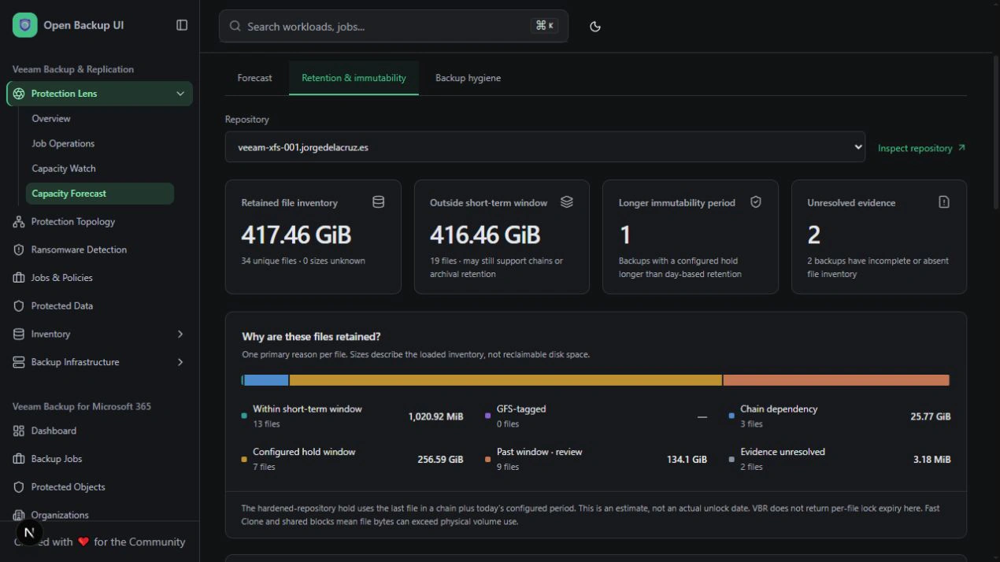

*Understand why backup files are retained.*

*Review stale backups and unresolved ownership.*

## Jobs and recovery

### Jobs & Policies, redesigned

The job inventory now shares the Operations table styling, expanding search, compact controls, column choices, and pagination. Sort by last or next run and keep the existing creation and job-management actions close at hand.

*A consistent home for jobs and policies.*

### A clearer job builder

Create VMware vSphere and Hyper-V jobs through four focused stages: workloads, storage, policies, and review. Browse live inventory, check the configuration against the source before submission, and inspect or export the API payload.

*Build a protection plan in four focused steps.*

### Policy Profiles

Save reusable **retention**, **guest-processing**, and **schedule** settings under **Jobs & Policies → Policy Profiles**. Import, export, duplicate, and revise profiles, then apply a copy to a new job. Updating a profile does not silently change existing jobs.

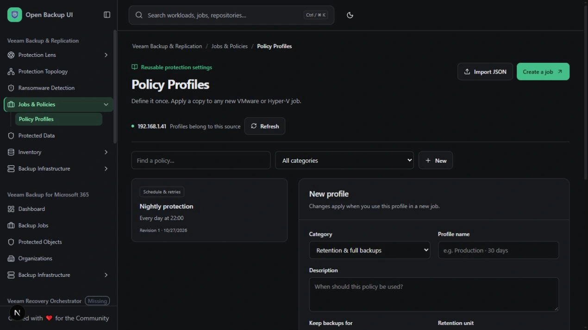

*Define shared settings once. Reuse them in new jobs.*

### Job and session investigation

Bring session history, per-workload errors, session logs, and task logs into one investigation flow. Follow retry chains when the API supplies the relationships, and export the filtered log evidence.

*Follow the failure down to the workload.*

### Protected Data and HexMap

Review backup coverage, restore-point counts, reported sizes, and recovery age in a consistent inventory. Keep the HexMap toggle, now with workload names, clearer RPO colors, smarter time-unit controls, and cached loading.

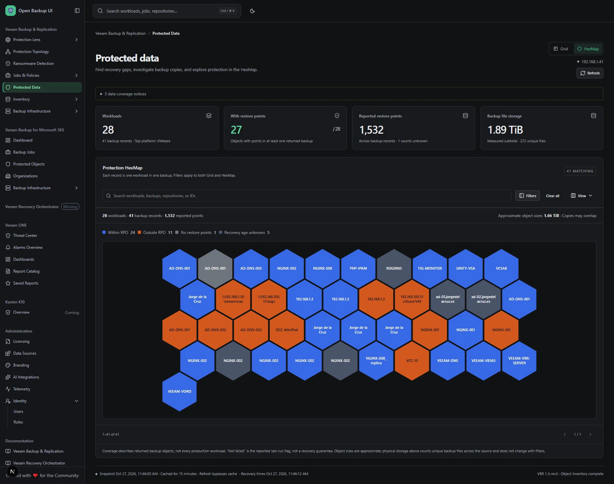

*Scan recovery age without losing workload identity.*

### Restore-point investigation

Inspect freshness, repository location, reported malware status, and available recovery operations in the Operations layout. Shared backup files are counted once, and unavailable values remain explicit.

*Inspect recovery options and their supporting evidence.*

### Protection Topology and workload resilience

Follow confirmed **workload → job → repository** relationships in a map or list. Open a workload's resilience explorer to compare restore points across repository lanes and investigate protection gaps.

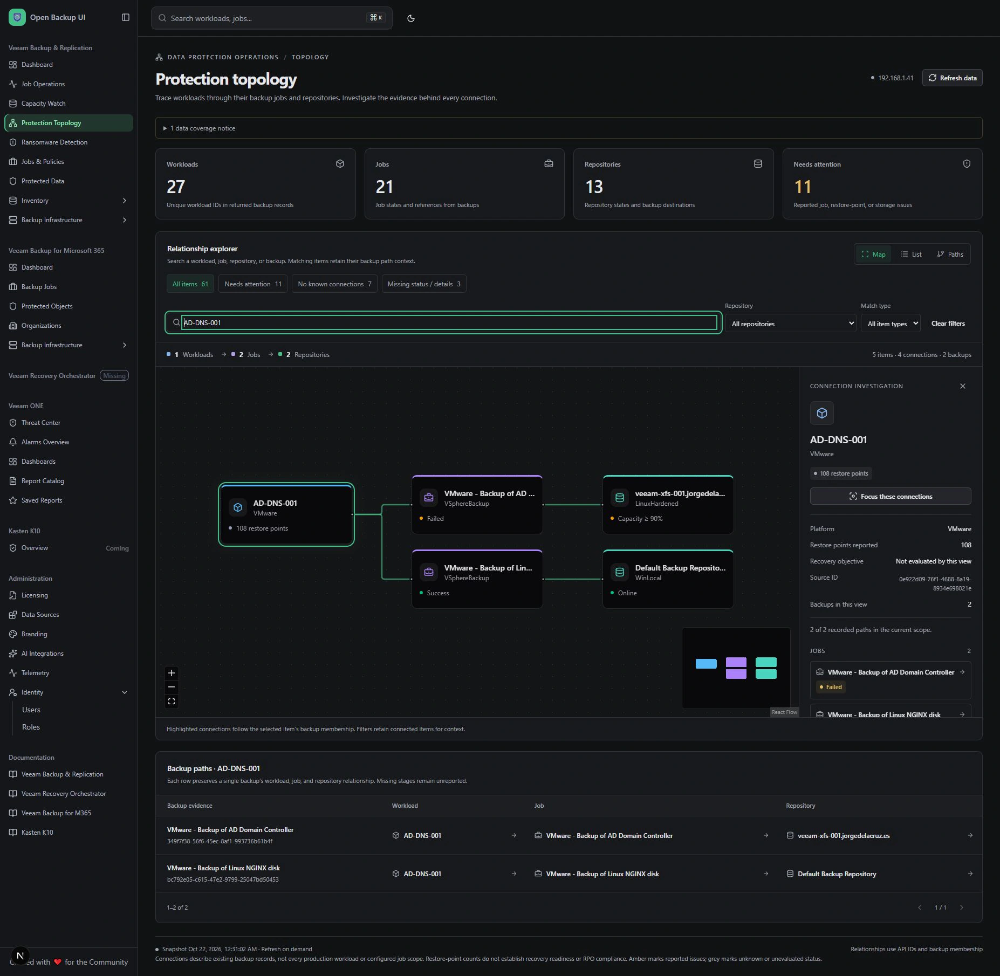

*Trace workload, job, and repository relationships.*

*Compare recovery evidence across locations.*

### Ransomware Detection

Review native suspicious-activity events, affected workloads, detection settings, and recovery-point links. The existing backup data-reduction indicators remain available as a separate investigation view.

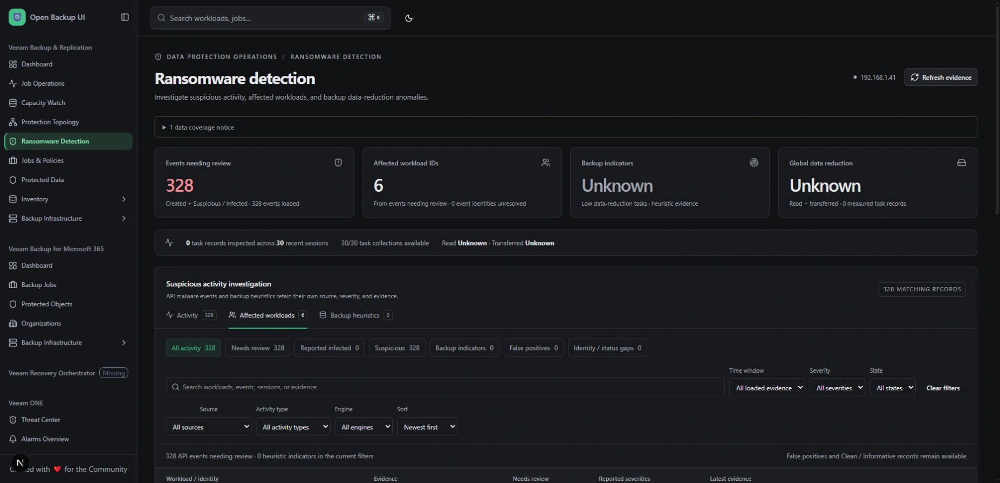

*Investigate suspicious activity in context.*

## Infrastructure and inventory

### Storage investigation in one place

Repository lists and details bring together scale-out grouping, capacity, backup consumption, immutability configuration, and directly affected jobs.

*One storage investigation workspace.*

### Proxies and managed servers

Investigate proxy availability, transport modes, and concurrent-task limits. Managed-server views add component-update status and assigned roles, with consistent issue filters and drill-downs.

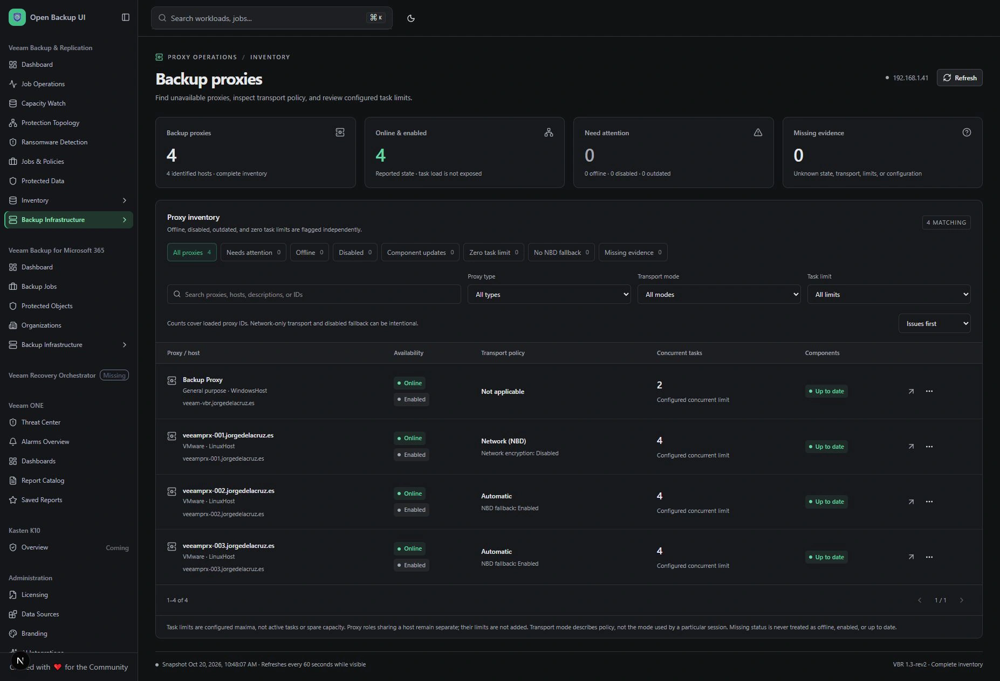

*See the proxy conditions behind backup performance.*

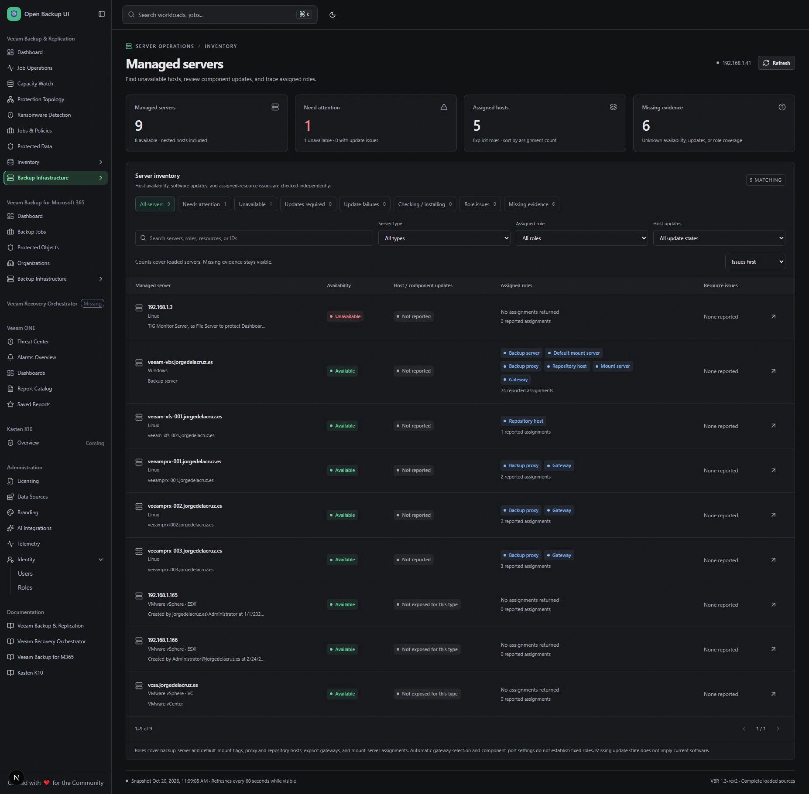

*Review server readiness and responsibilities.*

### Production and protection together

Virtual Infrastructure keeps its vCenter, cluster, host, VM, size, and protection data in the new layout. Protection Groups expose discovery and agent health; Unstructured Data covers file shares and object storage while preserving existing actions.

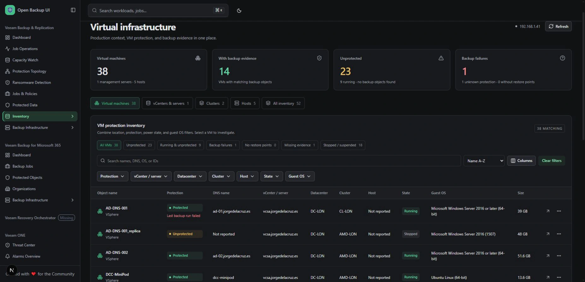

*Production and protection, together.*

*Spot discovery, agent, and update issues.*

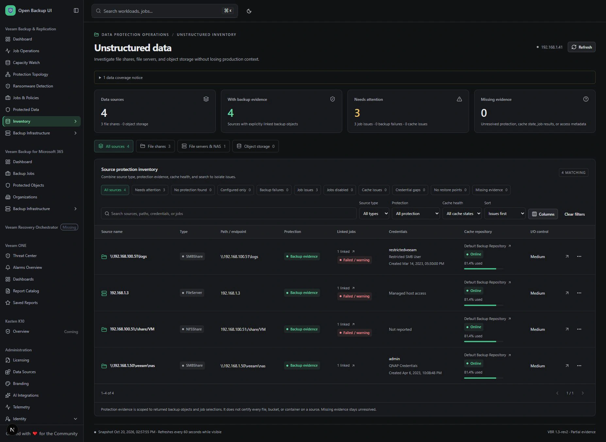

*Keep unstructured protection in view.*

## Microsoft 365 and Veeam ONE

### Microsoft 365 Operations

The dashboard, backup jobs, protected objects, organizations, repositories, and proxies now share the Operations experience. Review job health, sessions and workload errors, backup evidence, storage usage, immutability settings, and proxy availability. Protected Objects retains its HexMap.

*The Operations experience for Microsoft 365.*

*Investigate Microsoft 365 backup failures.*

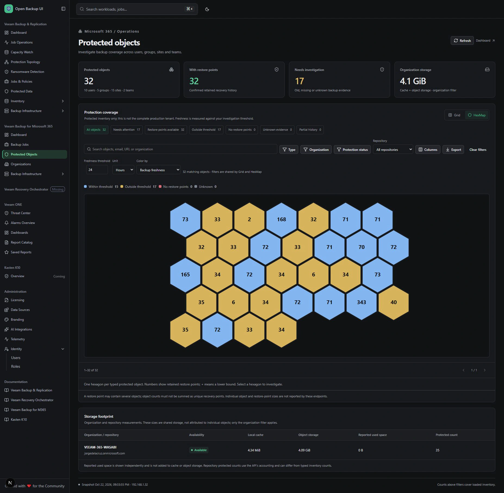

*Explore protected objects and their recovery evidence.*

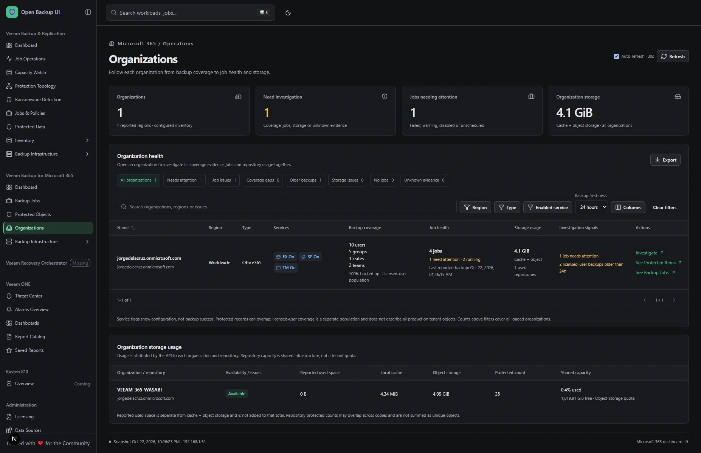

*Understand protection at the organization level.*

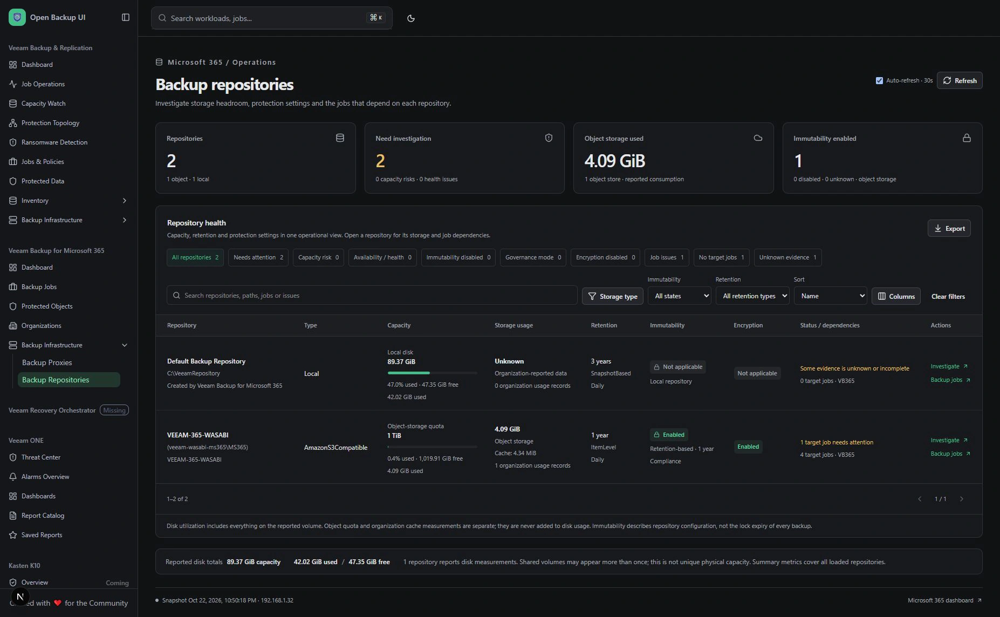

*See capacity and immutability without mixing storage types.*

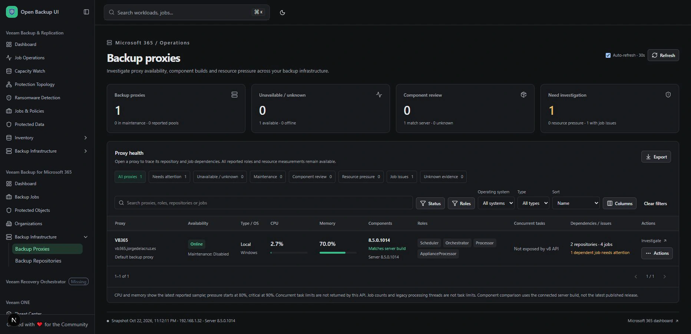

*Review proxy readiness in one place.*

### Veeam ONE Alarm Operations

Investigate severity, affected objects, alarm age, history, full descriptions, and knowledge-base guidance. Native CSS/SVG visuals replace the legacy overview charts, with existing exports and resolution actions preserved.

*Turn alarm volume into an investigation queue.*

### Veeam ONE Report Operations

Browse the report catalog and saved reports, set API-driven parameters, follow execution status, and inspect complete paged results. Tables, summaries, and native charts retain source values and links to the native viewer.

*From report selection to usable results.*

## A consistent experience

### Global search with context

Search VBR and Microsoft 365 workloads, jobs, and repositories from a keyboard-friendly search workspace. Scope results, preview health and recovery facts, revisit recent items, and follow suggested matches for small typing mistakes.

*Find the object. Preview the context. Jump into investigation.*

### Less toolbar clutter

Expandable filter groups live in a left rail, with selectable options and **Clear all** beside **Filters**. Grids gain consistent sorting, date ordering, compact controls, and breadcrumbs. On phones, the main menu opens above the content.

*Powerful filters with less toolbar clutter.*

*Navigation that fits a phone.*

### Operations and Glass themes

Choose the Operations theme or **Glass Ocean**, **Glass Forest**, and **Glass Aurora** for layered backgrounds and translucent panels. Every preset supports light and dark modes. Branding includes fonts, accent colors, density, corner radius, content width, and a live preview, so the same operational views can suit your preferred appearance.

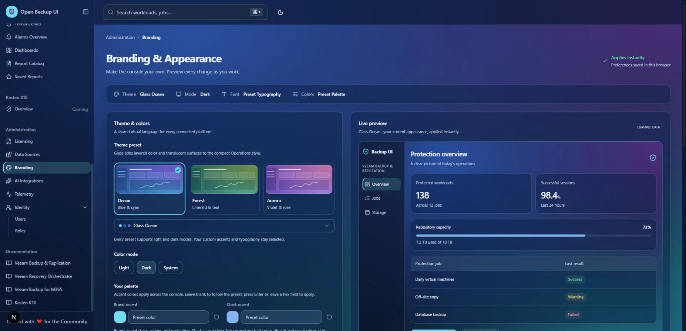

*Choose the atmosphere. Keep the same operational clarity.*

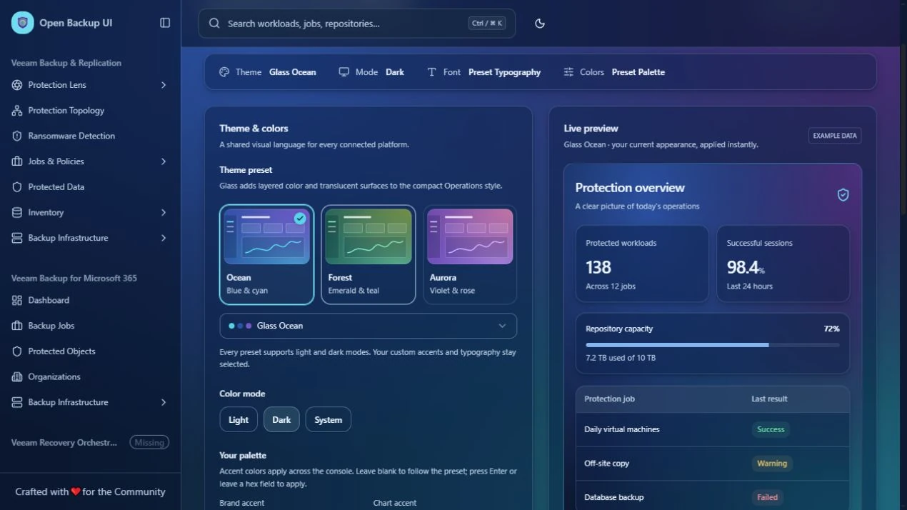

*Glass Ocean: cool blue surfaces and a live preview of the console.*

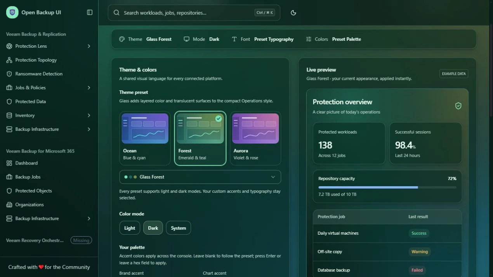

*Glass Forest: emerald and teal surfaces with the same operational controls.*

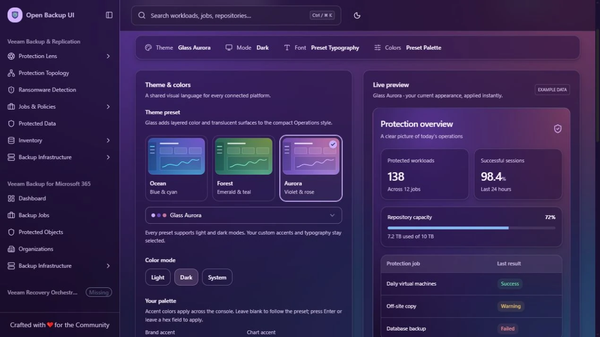

*Glass Aurora: violet and rose accents, with consistent status and result colors.*

### Eleven interface languages

Choose **Administration → Settings → Language & region** to follow your browser language or save an explicit preference. English, Spanish, German, Russian, French, Brazilian Portuguese, Simplified Chinese, Japanese, Italian, Korean, and Hindi are bundled with the application. Translation runs locally without an external translation service.

The localized VBR workspaces include Protection Lens widgets and banners, job operations, capacity and forecast investigations, topology, ransomware detection, Jobs & Policies, Policy Profiles, Protected Data, and Virtual Inventory. Counts, status labels, filters, descriptions, menus, and known application-authored diagnostics follow the selected language. Active Backup Copy and Entra ID creation forms include their validation and progress messages.

Localization extends into VBR job/session and repository investigations, workload/task drawers, restore-point calendars, and Microsoft 365 job/session, organization, repository, proxy, and recovery details. Localized views format dates and numbers for the selected locale. Optional AI health summaries request narrative content in that language.

Product names, custom section names, workload and repository names, IDs, paths, vendor logs, and upstream messages retain their source values. **Protection Lens** remains the feature name in every language. See the [language and coverage guide](../i18n.md) for the migrated areas, English fallback behavior, and remaining legacy boundaries.

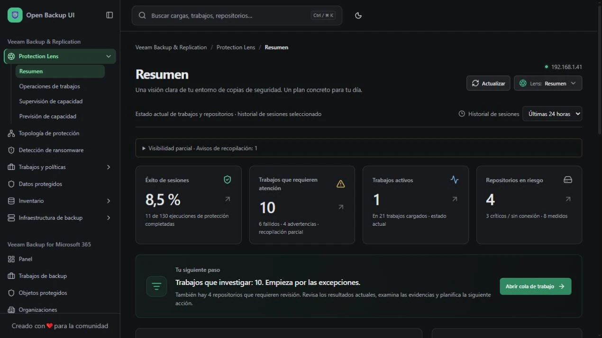

*The same protection picture, with interface guidance in Spanish.*

### A visual introduction on Connect

The `/connect` page introduces the console through feature screenshots alongside the source connection flow. Browse the feature selectors or use the previous/next controls; pause the carousel whenever you want to inspect a view. Captions use the selected interface language, and automatic rotation respects reduced-motion preferences. Screenshot pixels retain the language in which they were captured.

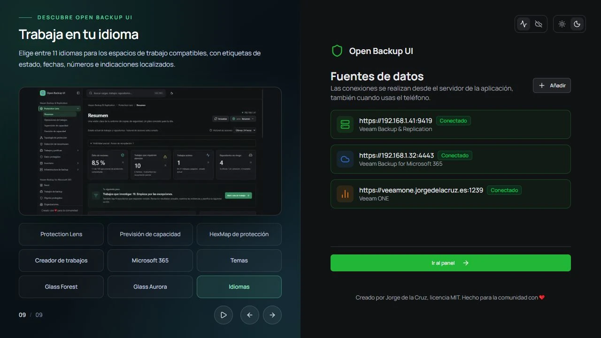

*Explore protection, planning, themes, and languages before opening the console.*

### HTTPS and certificate settings

Deploy behind your existing HTTPS reverse proxy or use the optional `npm run start:https` launcher. Managed HTTPS creates a unique certificate on first start and provides certificate identity, validity, and fingerprint information under **Administration → Settings → HTTPS & certificates**.

With a dedicated HTTPS administration token configured, install a matching PEM server certificate/private key and optional certificate chain. The server checks the certificate and applies a valid replacement to new connections without restarting the application. Invalid replacements leave the current certificate active. See the [HTTPS guide](../https.md) for setup, persistence, certificate trust, and reverse-proxy deployment details.

### Administration, brought together

Licensing combines usage, capacity, and expiration across VBR and Microsoft 365. Data Sources, AI Integrations, Telemetry, and Identity receive consistent configuration, status, diagnostics, and investigation views.

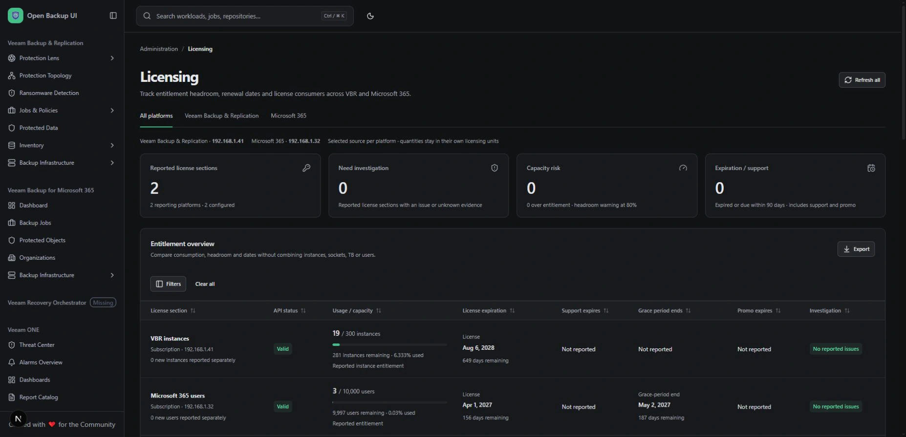

*Review license headroom and upcoming expirations.*

*Know which connections are ready.*

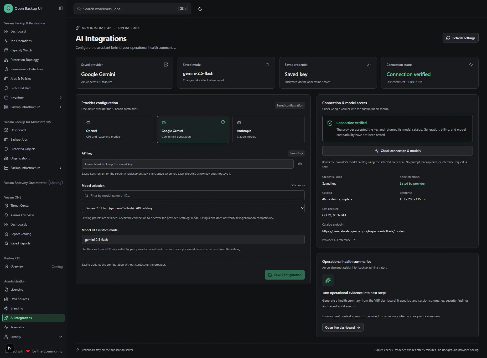

*Configure optional AI summaries on your terms.*

*See and control telemetry behavior.*

*Investigate access with users, roles, and permissions together.*

## Before upgrading

- Install dependencies on the destination machine with `npm ci`. Ordinary `npm install` is also supported; neither needs `--legacy-peer-deps` or `--force`. Source downloads exclude `node_modules` and build output.
- Back up the persistent `data/` directory and its encryption key. Policy Profiles and capacity history are stored locally with the existing configuration.
- Managed HTTPS also needs persistent, protected certificate storage. HTTPS is optional and does not introduce an application-administrator login; retain your existing access controls.
- Capacity collection needs a persistent Node server or container and writable storage. Physical forecasting needs at least three daily readings spanning 48 hours.
- API versions, permissions, and returned evidence determine available features. Unknown or partial evidence is labelled; a successful backup or a displayed restore point is not proof of recoverability.
- Forecasts and backup-hygiene findings are advisory. They do not delete files, change retention, or prove that space is reclaimable.
- Review [deployment and access requirements](../deployment.md) before sharing an instance. This remains an independent community project, not a vendor-supported product.

[README](../../README.md) · [Screenshot checklist](v1.0.0-screenshots.md) · [Validation scope](v1.0.0-validation.md)
